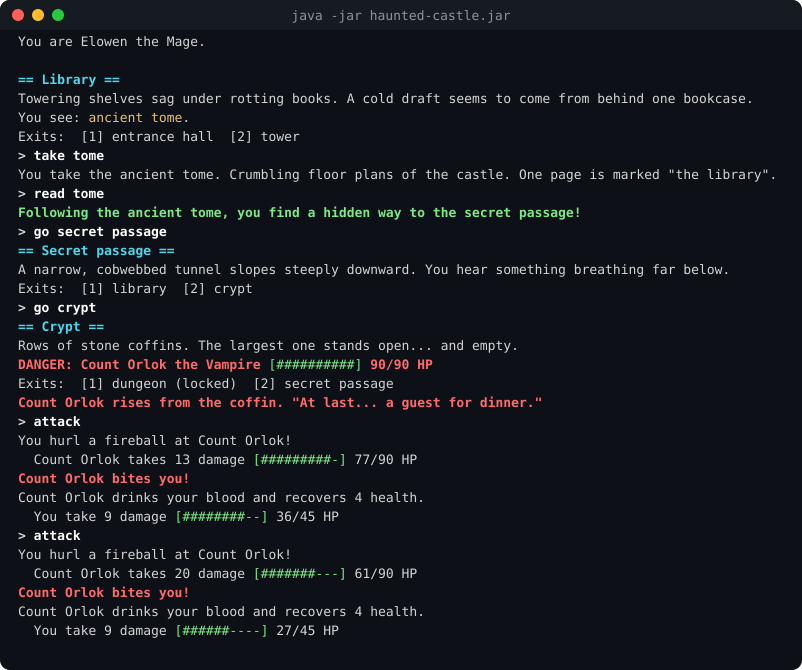

# The Haunted Castle

[](https://github.com/GuldenSagymbayeva/haunted-castle/actions/workflows/ci.yml)


A turn-based text adventure in plain Java, with no runtime dependencies. Explore a cursed castle,
outwit five kinds of monsters with their own rules, find keys, secret passages and a silver
dagger, and destroy the vampire Count Orlok to break the curse.



## Play

**Easiest:** download `haunted-castle.jar` from the
[latest release](https://github.com/GuldenSagymbayeva/haunted-castle/releases/latest) and run

```sh
java -jar haunted-castle.jar
```

**From the source code** (needs Java 17 or newer, the JDK):

| Windows | macOS / Linux |
|---------|---------------|
| double-click `play.bat` | `./play.sh` |

Options: `--difficulty easy|normal|hard`, `--seed N` (repeatable dice), `--no-color`, `--help`,
or a path to your own world file.

## Features

- **Two heroes.** Sir Roderick the Fighter is tough and lands double-damage critical hits.
  Elowen the Mage is fragile but throws magic fireballs, paid for with mana that refills each turn.
- **Monsters with their own rules:**

  | Monster | Rule |
  |---------|------|
  | Slime | Hits harder the bigger it is, so it weakens as you hurt it |
  | Skeleton | Pulls itself back together once, unless destroyed by silver or magic |
  | Ghost | Ordinary blows pass straight through it half the time |
  | Werewolf | Flies into a rage below half health; silver burns it for double damage |
  | Vampire | Heals by drinking your blood; only silver or magic can deliver the final blow |

- **Turn-based combat.** Monsters strike back every turn you stay, may hit you as you flee,
  and guard the items in their room.
- **11 rooms**, with locked doors, a hidden passage revealed by an ancient tome, and a telescope
  that maps the castle.
- **Items:** potions, weapons, armour, throwable holy water, keys.
- **Save and continue.** `save` at any time; next launch offers to continue.
- **Three difficulty levels**, a score and a rank at the end.
- **Help when stuck:** `hint` looks at what you have seen and carry and suggests a next step.
- **Forgiving input:** `go lib`, `take all`, or just type an exit number or room name.
- Colour output with health bars (turned off automatically when output is not a terminal).
- **Your own castles:** worlds are plain text files (see below).

## Commands

| Command | Effect |
|---------|--------|
| `look`, `look <thing>` | Describe the room, or examine an item, a monster or `me` |
| `go <room or number>`, `back` | Move through an exit / return the way you came |
| `take <item>`, `take all` | Pick things up (monsters guard their room's items) |
| `use <item>` (also `read`, `drink`, `wield`, `wear`, `throw`) | Use an item |
| `attack [monster]` | Fight |
| `inventory`, `stats`, `map`, `hint` | Check yourself and the castle |
| `wait`, `save`, `quit`, `help` | |

Score = (500 + 100 per monster vanquished + 5 per HP left - 5 per turn) x difficulty bonus.

## Make your own world

Worlds are plain text, one command per line. Underscores become spaces; `#` starts a comment.

```
ROOM <room>
DESC <room|item|character> <free text...>
CONNECT <room> <room>                # two-way path
LEADS_TO <from> <to>                 # one-way path
LOCKED <room> <room> <key item>      # two-way path opened by a key
HIDDEN <from> <to> <item>            # one-way path revealed by using an item
FIGHTER | MAGE <name> <start room>   # playable heroes (at least one)
VAMPIRE | SKELETON | SLIME | GHOST | WEREWOLF <name> <room>
GOAL <character>                     # win when it is vanquished (default: clear every monster)
ITEM <name> <room> [KEY | TOME | SPYGLASS | POTION <heal> | ARMOR <block> | THROWN <damage>
                    | WEAPON <bonus> [PHYSICAL|SILVER|MAGIC]]
```

The built-in castle is [`src/main/resources/worlds/hauntedcastle.txt`](src/main/resources/worlds/hauntedcastle.txt).
Run your own with `java -jar haunted-castle.jar my_castle.txt`. Mistakes are reported with the
file name and line number.

## Build and test

```sh
./mvnw verify          # Windows: mvnw.cmd verify
```

This compiles with all warnings treated as errors, runs 37 JUnit 5 tests and builds
`target/haunted-castle.jar`. No Maven install is needed: the wrapper downloads it.
GitHub Actions runs the same build on Java 17 and 21 for every push, and attaches the jar to a
GitHub Release for every version tag.

## Design

```
src/main/java/hauntedcastle/
  Main.java              options, new game or continue, play-again loop
  game/   Game           command loop, turns, combat narration, hints, saving
          GameLoader     world-file parser (file or bundled resource)
          GameData       rooms, characters, items, heroes and goal of one world
          SaveGame       save file format
          Difficulty, Style, Lookup
  world/  Room, Exit     rooms; exits may be locked by a key or hidden until revealed
  item/   Item + Key, Potion, Weapon, Armor, ThrownItem, Tome, Spyglass
  character/
          GameCharacter, Attack, DamageType
          monster/  Monster + Slime, Skeleton, Ghost, Werewolf, Vampire
          hero/     PlayerCharacter + Fighter, Mage
```

Decisions worth pointing out:

- **Polymorphism instead of `if` chains.** Every blow is an `Attack` (damage, type, verb). Each
  monster's rule lives in its own override of `attack`, `takeHit` or `afterDealing`, and each
  item's effect in its own `use`. Adding a monster is one small class plus one line in the loader.
- **Data-driven world.** Rooms, paths, locks, secrets, monsters and items come from a text
  file, so the game engine knows nothing about this particular castle.
- **Save by replay.** All randomness comes from one seeded `Random`. A save file stores only the
  seed, the difficulty, the hero and the commands typed. Loading replays them silently, which
  rebuilds every detail (health, mana, unlocked doors, dice) without serialising any object.
- **Tested balance.** `BalanceTest` plays thousands of simulated fights with the real character
  classes. It keeps the intended difficulty curve: rushing the vampire usually fails, exploring
  first usually wins on Normal, and Hard is clearly harder. Numbers were tuned with the same
  simulation.
- **Deterministic tests.** Scripted play-throughs run against the real world file with fixed
  seeds, so every test is repeatable.

## Background

This started as a university object-oriented programming lab: load rooms, characters and items
from a file. I extended it into a complete game: the command loop, combat, items, saving,
difficulty, the larger castle, tests, packaging and CI.

## License

[MIT](LICENSE)
